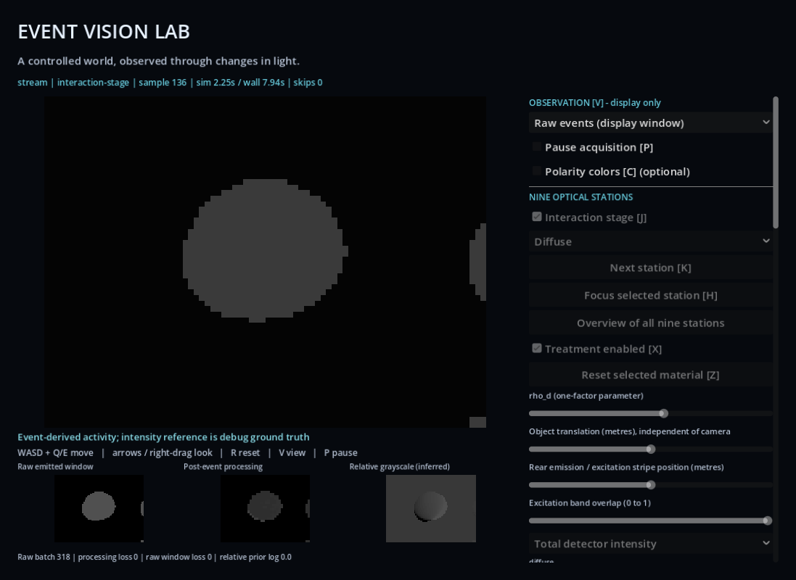

# Next Event Vision Lab prototype

November 28, 2026, Asia/Seoul. The goal is a practical event-vision simulator without an event camera. This revision connects a navigable nine-station optical stage to complete ideal-event acquisition, bounded live perception, and optional relative-grayscale inference. A game objective is not required.

## Implemented groups

| Group | Issues | PR |
| --- | --- | --- |
| Surface and transmission | #17–#21 | [#26](https://github.com/pianojay/event-vision-lab/pull/26) |
| Excitation and afterglow | #22, #24 | [#27](https://github.com/pianojay/event-vision-lab/pull/27) |
| Spatial and indirect transport | #23, #25 | [#28](https://github.com/pianojay/event-vision-lab/pull/28) |
| Perception and relative inference | #11–#15 | [#29](https://github.com/pianojay/event-vision-lab/pull/29) |
| Complete live acquisition | #10, #4, #7 | [#30](https://github.com/pianojay/event-vision-lab/pull/30) |
| Generic offline sensor and readout | #5 | [#31](https://github.com/pianojay/event-vision-lab/pull/31) |
| Composed validation | #16, #2, #15 | [#32](https://github.com/pianojay/event-vision-lab/pull/32) |
| Nine-station stage and integration | #1, #6, #7–#9 and their children | [#33](https://github.com/pianojay/event-vision-lab/pull/33) |

Each group received independent GPT-6.1 Sol verification. Merge commits preserve component history. Original component branch heads were retained; their clean checkouts were reused with one writer each. GPU jobs were serialized. No Computer Use or remote-host execution was used.

## Optical and event evidence

The [final matrix](../evidence/2026-11-28/composed-stage/matrix-v3-results.json) passes **189/189 checks over 45 captures**. It uses treatment, control, static, doubled temporal cadence, and doubled spatial dimensions for each station. All nine static cases emit zero events. Count-density refinement tolerances were recorded before capture: temporal 0.35 and spatial 0.5. Every case passes complete-capture and independent full-frame sensor comparisons against the same archived FP32 optical samples. The [protocol](../evidence/2026-11-28/composed-stage/matrix-protocol.json) retains settings and source hashes.

The [first](../evidence/2026-11-28/composed-stage/matrix-v1-results.json) and [second](../evidence/2026-11-28/composed-stage/matrix-v2-results.json) failed matrices remain retained. The first exposed unrelated background activity and small-contrast cancellation; the second exposed two emitters moving together. The final source drives the selected physical emitter independently. Gates and the central region did not change. This is validation of the revised bounded experiment, not predictive validation of the original stimulus. One initial-start timeout, an invalid unquoted-path retry, and the successful exact-config retry remain in the [retry ledger](../evidence/2026-11-28/composed-stage/matrix-retry-ledger.json).

The [four regenerated camera configurations](../evidence/2026-11-28/composed-stage/camera-results.json) have no missing/extra events or polarity mismatch. Worst timestamp error is **14,116 ns**, below the unchanged 100,000 ns gate. Stable near-anchor log ratios fix the previously retained one-sample timing errors; see the [investigation](../evidence/2026-11-28/composed-stage/timing-investigation.md). This does not establish an arbitrary-input timing bound.

[Recorded optical probes](../evidence/2026-11-28/composed-stage/optical-probes.json) retain pre-floor linear intensity, floor/log changes, source/camera/material state, and emitted events at five fixed pixels in each treatment/control case. They can miss localized effects; full-frame comparisons use every pixel. The full FP32 archives remain locally retained under `runs/stage-matrix-v3`, and the committed runner regenerates them. Independent isolated optical references and their linear/log/event errors remain in [the material evidence](../research/materials/README.md). This matrix is not an independently converged general renderer.

[Separate motion trials](../evidence/2026-11-28/composed-stage/independent-motion-results.json) pass all eight full-frame sensor comparisons and both glossy camera refinement gates. The predeclared whole-frame lamp-only prediction failed with 1,090 events. [Post-result localization](../evidence/2026-11-28/composed-stage/negative-control-localization.json) finds zero events and bit-identical optical input in the previously fixed central region. Peripheral fluorescence contributes 694 events and phosphorescence 396. Station selection does not turn off other visible materials. This failed prediction remains a result, rather than being replaced with a passing whole-frame claim.

## Sustained recorded profiles

Both profiles use the final composed application at source `446417c4007bffe8ddf87157e12778403a42a6e9`, ten seconds of warmup, at least 600 measured wall seconds, and AC confirmed in every process sample. Hardware is Intel Core i7-1065G7 / Iris Plus on Windows 11; official Godot 4.7.2, Vulkan Mobile, driver 30.0.100.9836. The sensor is 80×60 with a 16,666,667 ns target period, post-event 2×2 bins and 100 ms decay. Presentation is capped at 60 FPS; target rates are not achieved-rate claims. The 12 Hz dense stimulus occupies measured seconds 200–400.

| Recorded quantity | Inferred view hidden | Inferred view shown |
| --- | ---: | ---: |
| Measured wall / simulated seconds | 600.023 / 333.333 | 600.024 / 326.667 |
| Emitted events / sample batches | 13,004,844 / 20,000 | 12,693,040 / 19,600 |
| Frame interval median / p95 / p99, ms | 19.270 / 35.129 / 638.670 | 20.268 / 33.225 / 637.089 |
| Sample service median / p95 / p99, ms | 7.830 / 13.406 / 369.468 | 7.915 / 12.535 / 368.216 |
| Peak renderer private bytes, MiB | 413.42 | 407.22 |
| Optical skips / processing overflow | 0 / 0 | 0 / 0 |
| Raw display events dropped across resets | 168,263 | 170,729 |
| V / R acknowledgement observations, ms | 43.447 / 50.216 | 52.208 / 42.914 |

Full [processing](../evidence/2026-11-28/composed-stage/stage-processing/sustained-report.json) and [inference](../evidence/2026-11-28/composed-stage/stage-inference/sustained-report.json) records retain effective settings, actual renderer image/hash, power, memory samples, frame/batch/service timings, loss counters, input acknowledgements, inference age, and clean stream finalization. The same renderer process owns the graphics context and memory measurements; the small console wrapper is resolved before launch.

The simulation slows under load rather than skipping optical intervals. Raw display is a bounded, lossy observation window; those drops are separate from sensor generation and processing. These runs request no event CSV archive, so unrecorded events are counted as capture-not-requested, not capture overflow. The ideal sensor suppresses no events and models no readout queue. The configured one-hour simulation is deliberately not marked complete at wall stop.

Sample service ends before main-thread processing. Input latency is internal key injection to Godot post-draw acknowledgement, excluding a physical device, OS input, compositor and monitor. The two V/R measurements are individual observations, not a latency distribution. Inference age is measured against the simulated acquisition cursor; synchronous zero age can coexist with large wall slowdown. Whole-process memory slopes include warmup/driver allocations and do not diagnose a leak. The workstation remained available for other use; small report preparation occurred concurrently. No comparative speedup or isolated-machine performance claim is made.

The inferred-view toggle preserves a warm bounded log estimate even while hidden; it controls the image/pane, not a compute-off ablation. Both profiles therefore include forward contrast accumulation.

## Output and useful observation

The [limited all-modes clip](../evidence/2026-11-28/composed-stage/output/limited-allmodes/output-analysis.json) records 58 complete SDR rendered frames with no identity gaps, inference enabled, all four observation views, and all three processing representations. Its conservative whole-clip extrema area bound passes at **2.6714%** of the 341×256 reference window. The [opt-out clip](../evidence/2026-11-28/composed-stage/output/opt-out/output-analysis.json) is complete but its **71.5245%** bound is inconclusive. Neither result is a safety certification, flash-rate measurement, app-wide accessibility finding, human-usability test, HDR/zoom claim or calibrated-display result. Startup before warmup is outside these clips.



The default display maps media to grayscale with maximum linear SDR luminance 0.08 and encodes it as sRGB. The earlier encoded-value multiply reached only RGB8 20 / linear luminance 0.007 in a recorded pane. Correcting that transfer improved visibility while preserving optical and sensor values. UI/labels remain included in the full-viewport analysis.

The [normal startup check](../evidence/2026-11-28/composed-stage/startup/after/report.json) uses source `7c050a8`, the normal PackedScene and no acquisition override. The old absorption-first startup had zero central-window activity; the diffuse-first startup records 785 central-window events at about three wall seconds and a visible curved surface. This one-constant default change does not enter the prescribed acquisition branch used by the sustained profiles. Stage/control checks were rerun at 69/69 each.

Independent [same-capture tool observations](../evidence/2026-11-28/composed-stage/tool-observations/independent-observation.md) show sparse marks at 10 ms, a broken cluster at 40 ms, and more coherent contour fragments at 160 ms. Coarse count bins improve prominence while merging nearby detail; per-pixel normalization can hide sparse activity at fixed gain. All compared settings retain the same raw CSV hash. A central ROI removed no events in this capture, so no clutter-suppression benefit is claimed. Polarity and display coloring are distinct.

Independent blinded [nine-station observations](../evidence/2026-11-28/composed-stage/station-observations/blinded-review.md) and [pulse-aligned observations](../evidence/2026-11-28/composed-stage/station-pulse-observations-v2/blinded-review.md) use only emitted events. Original windows missed a brief source-off burst; the revised windows bracket the declared source-off time. Some conditions remain visually similar or saturated. Persistent afterglow and an additional indirect-light region are observable. These are AI observer records, not human comprehension or material-classification results. Static plots use their declared gain/window mappings, distinct from the app display limiter.

Separate runs with the same optical trajectory and a fixed multiplicative reflectance or input-intensity scale have the same temporal log contrast while intensities remain above the numerical floor. Changing that factor during a run is an optical change and can emit events. Uniform time-varying strobing supplies common-mode contrast; it is not a spatially coded projector. Moving illumination, occlusion and spatially varying sources reveal useful contours, but this prototype does not recover normals or depth. More darkness or a material label alone does not guarantee fewer or more ideal events.

## Profiles, boundaries and limits

The [acquisition contract](live-acquisition-v1.md), [stage guide](interaction-stage.md), [CPU profile contract](pipeline-v1.md), and [generic sensor contract](../research/sensor/generic-model.md) describe separate supported choices. GPU acquisition is ideal, sampled log-linear interpolation with integer interval clocks. The offline generic model uses held input, finite response, threshold mismatch, refractory gating, seeded phenomenological activity, and separate bounded readout. Their semantics are not interchangeable. Unsupported configurations are rejected rather than silently approximated.

The generic model has pinned IEBCS same-flux temporal/statistical comparisons, analytical schedule/queue references, timestep checks, cost data, and unchanged ideal regression. Different reset/noise/queue laws are retained; no whole-model IEBCS parity, physical leak-current calibration, real-device profile, or live GPU nonideal model is claimed. Camera-specific validation is conditional on making a camera-specific claim; none is introduced.

The nine optical models are bounded explicit approximations: Beer attenuation; Lambert diffuse; conservative cosine-power glossy; thin non-bending transmission; primary slab/sphere Snell/Fresnel paths; two-band prompt fluorescence; causal stored-energy afterglow; restricted slab diffusion; and uniform two-patch diffuse radiosity. No general caustics, dispersion, arbitrary subsurface geometry, full spectra, or calibrated camera/lens response is claimed. Registry model ranges and the measured sampling envelope are different: a valid narrow-glint parameter is not proof that every cadence/resolution resolves it.

Existing scalar timing phase/rate results and known missed narrow pulses remain in [the timing report](../research/timing/results-2026-11-22.md). Fixed optical sampling cannot recover changes between equal endpoints. Integer event timestamps do not remove FP32 optical-time precision or near-flat numerical conditioning limits.

Relative grayscale is constant-prior contrast integration, not learned reconstruction or absolute appearance recovery. Truth is read only for separately labelled scoring. Static unobserved texture and global intensity remain unknowable. Final unaligned log RMSE is 7.399 for the zero-event static case, 3.044 for moving light, 2.687 for camera motion, 3.222 for glossy, and 2.526 for transmission. These are quality failures of the unknown-prior baseline, not recovered absolute appearance. Each retained reconstruction JSON separately reports explicit global-offset alignment and the declared evaluation floor; neither enters inference.

## Reproduce and review

```powershell
./run-lab.ps1
python -B tools/stage/experiment.py prepare runs/new-stage-matrix
./tools/stage/run-matrix.ps1 -Protocol runs/new-stage-matrix/protocol.json
# See composed-validation.md for hidden AC profiles and recorded-output commands.
```

Use fresh directories and serialize GPU jobs. Full source/configuration/hardware identities travel with each result. The code used for the optical matrix is `53dcfdc`; later changes before runtime source `446417c` are generic CPU/evaluator/documentation integration, with the same stage/GPU behavior. Subsequent evidence and merge-history commits must preserve that measured code identity or receive new checks.

The retained [resolution audit](../evidence/2026-11-28/composed-stage/resolution-audit.md) maps all 24 original issues without adding calibration, universal parity, or formal-study requirements. [The journal snapshot](../evidence/2026-11-28/composed-stage/decisions.tsv) records implementation decisions and superseded evidence. Historical missing-reset, wrapper-memory, collapsed-layout, invalid test-harness C/U-acknowledgement, and failed numerical results were not relabelled as successes. Production C/U shortcut routes are separately covered by the control tests.

Foundational Thinking kept optical/sensor/processing state separate. Model the Domain gave material population its own lifecycle. Separate Before Serializing Shared State assigned one writer per checkout and one GPU owner. Sequence Work into Verifiable Units produced the eight PR groups. Prove It Works required real artifact execution. Explain the Number corrected wrapper telemetry and output layout before measurements. Attack the Premise replaced repeated absolute-log fixes with a direct log-ratio experiment. Experience First selected the active diffuse experiment after observing the blank central startup. Make Operations Idempotent reconciled tracker updates from their actual read-back state without duplicate comments.

The [final trail audit](../evidence/2026-11-28/composed-stage/decision-trail-final-audit.md) was independently reviewed by GPT-6.1 Terra within the configured OpenAI-only model set. It preserves the remaining interpretation limits and approximate early journal timestamps. The current [canonical journal](../../.audit/next-version-decisions.tsv), [PR status](../evidence/2026-11-28/composed-stage/pr-status-final.json) and [24 issue resolution records](../evidence/2026-11-28/composed-stage/issue-resolutions.json) record the completed promotion to `main` and criteria-based closure. The earlier journal copy remains a measurement-stage snapshot.
