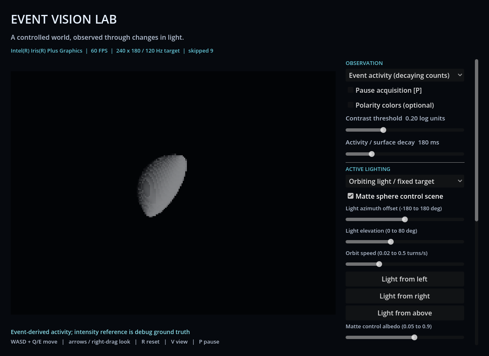

# Godot shader prototype

Current implementation: November 22, 2026. A controllable event-vision laboratory without a physical camera. The active-lighting extension addresses [#1](https://github.com/pianojay/event-vision-lab/issues/1) and provides initial display changes for [#2](https://github.com/pianojay/event-vision-lab/issues/2). Neither issue is considered fully resolved.

## Run on Windows

```powershell
.\run-lab.ps1
.\run-lab.ps1 -Editor
.\run-lab.ps1 -Validate
```

Or double-click [Run Event Vision Lab.cmd](../Run%20Event%20Vision%20Lab.cmd), which uses Windows PowerShell 5.1. The launcher resolves the engine directory in this order: explicit `-GodotDirectory`, environment variable `EVENT_LAB_GODOT_DIR`, shared `C:\Godot_v4.7.2-stable_win64.exe\`, then checkout-local `tools/godot/4.7.2/`. Explicit paths must be valid; they do not silently fall back. Both standard GUI and console executables are required, and the launcher checks for version 4.7.2. Engine binaries remain excluded from Git. A fresh clone/worktree on this machine can use the shared installation without copying binaries. Vulkan/Mobile is tested; D3D12 is an untested alternative. Headless import checks do not validate GPU execution.

```powershell
.\run-lab.ps1 -GodotDirectory 'C:\Godot_v4.7.2-stable_win64.exe' -Validate -EvidenceDirectory "$env:TEMP\event-lab-sensor"
.\run-lab.ps1 -ProfileSeconds 3 -EvidenceDirectory "$env:TEMP\event-lab-timing"
```

`-EvidenceDirectory` redirects logs/reports without changing which checkout's `prototype` runs. Use a distinct output directory per track and run GPU checks sequentially. Omitting it retains the historical output location and overwrite behavior. The launcher does not install Godot or change PATH/environment settings.

## First experiment: light moves, object does not

Startup uses a **stationary matte sphere**, an **orbiting point light**, **monochrome decaying event counts**, and **strobe off**. The changing appearance comes from varying illumination rather than a moving object. Scroll the right panel for additional controls.

| Control | Meaning |
| --- | --- |
| Fixed world light | Source stays independent of the camera; adjust azimuth/elevation or use left/right/above presets |
| Camera-mounted light | Point source follows camera position with a small offset; it is not a directional spotlight |
| Orbiting light | Source moves around `(0,1,-1)` at a three-unit radius; set elevation, starting-angle offset and orbit speed |
| Matte sphere control | Constant diffuse albedo, no specular term; disable to return to the original analytic room |
| Albedo / lamp strength | Vary reflectance independently of illumination amplitude |
| P / pause checkbox | Freeze acquisition, camera and the displayed simulation time for inspection |
| R | Initialize reference from current intensity; clear event history |
| 1 | Static sphere and fixed light: event view fades away |
| 2 | Stationary sphere with orbiting light |
| 3 | Original room, moving object and fixed light |
| V / observation selector | Activity counts, time surface, raw display window, debug intensity |
| WASD / Q/E; arrows / right-drag | Translate / raise/lower; look |
| Strobe checkbox / T | Explicit opt-in square-wave modulation; not required for the active-lighting experiment |

The azimuth/elevation presets reposition the source instantaneously; they are controlled lighting changes, not a physical motion trajectory. Orbit mode computes a new source position at every sensor step. The camera pose is interpolated across substeps. A fixed camera cannot reveal a change-free scene through ideal events alone.

## Research basis and scope

[EventPS (CVPR 2024)](https://ieeexplore.ieee.org/abstract/document/10655016) motivates varying illumination with a stationary event camera to study normals. [EventPSR (CVPR 2025)](https://openaccess.thecvf.com/content/CVPR2025/papers/Yu_EventPSR_Surface_Normal_and_Reflectance_Estimation_from_Photometric_Stereo_Using_CVPR_2025_paper.pdf) motivates deliberate illumination and material comparisons. This implementation adopts the **acquisition principle**, not those reconstruction algorithms or a reproduction of their experimental performance. No surface-normal estimator is implemented.

A camera-mounted lamp, movable point light, and orbit control are alternatives to global blinking. They are not structured-light triangulation. A projector baseline, spatial coding, calibrated sensor and depth inference remain future experiments. See [the research brief](research/strobe-observability-and-display.md).

## Sensor and visualization

The analytic compute shader generates deterministic linear radiance from geometry, diffuse cosine shading, inverse-distance attenuation and hard shadows. The room includes a simple specular term; the matte control omits it. Fixed ambient is an approximation. The ideal logarithmic sensor maintains contrast reference/residual, computes multiple ON/OFF crossings, and interpolates the last crossing time.

**Activity mode** integrates each polarity at every sensor step:

`H_next = exp(-dt/tau) * H_previous + crossing_count`.

The decay slider sets `tau`. This is an exponentially weighted count history, not an exact finite-window count or an intensity reconstruction. Bursts from earlier substeps remain visible even when the final substep has no events. Bounded display gain maps histories to grayscale by default; optional muted colors distinguish polarity. The other modes preserve timestamp-based time surfaces and raw presence within a display interval. The debug intensity view uses ground-truth radiance and is labeled accordingly.

State, event images and activity remain on GPU during ordinary interaction. A separate activity texture also holds cumulative per-polarity counts for numerical diagnostics; this is not a packed or globally sorted event stream. The 120 Hz simulation targets multiple freshly rendered samples per capped 60 FPS presentation frame. Skipped sensor intervals are reported.

## Validation and evidence

**25 GPU checks passed** on Intel Iris Plus. They include the original 16 sensor checks and nine new active-lighting/activity checks:

- Static sphere/fixed light is silent; changing direction produces both polarities and spatially varying responses.
- Sampled sphere radiance agrees with an independent analytic diffuse cosine/distance prediction within `1e-4` (measured 0.758555 versus expected 0.758576 in the recorded run).
- Ideal diffuse event counts remain equal between albedos 0.1 and 0.8 under the controlled illumination change. This illustrates log-ratio cancellation, not calibrated low-light behavior.
- Burst integration retains all substeps, agrees between grouped/serial dispatch, preserves OFF history and clears on reset.

Current evidence: [GPU checks](evidence/2026-11-22/active-lighting-tests.json), [GPU log](evidence/2026-11-22/active-lighting-tests.log), [interactive profile](evidence/2026-11-22/active-lighting-runtime.json), [runtime log](evidence/2026-11-22/active-lighting-runtime.log).

The final active-lighting profile recorded approximately 60 FPS (median 16.665 ms; p95 16.733 ms), 120 Hz sensor target and no skipped intervals after two-second warmup during a 12-second run. Short synchronous GPU timing was 0.761 ms median / 0.881 ms p95 per room+sensor sample. These are scoped measurements, not a sustained performance guarantee. Older `godot-*` evidence files preserve the initial prototype baseline.

```powershell
.\run-lab.ps1 -ProfileSeconds 12 -CapturePath 'D:\ChatGPT\Event Game\docs\evidence\2026-11-22\active-lighting-preview.png'
```

This updates the active-lighting profile and optional capture, not the historical baseline. `-View 3` selects debug intensity for a profile; 0 is activity, 1 time surface, 2 raw.



## Limits and remaining work

No noise, refractory behavior, finite photoreceptor bandwidth, calibrated materials, refraction, multi-bounce light transport, full event export, normal/depth estimation or learned reconstruction. A sampled strobe can alias, and endpoint interpolation is not exact physical jump timing. The matte sphere is a controlled test, not validation of a practical environment.

The [sensor fidelity review](research/sensor-simulation-fidelity.md) audits these limits against Event6D and established simulators. The [experiment plan](research/fidelity-experiment-plan.md) tracks temporal accuracy/event export (#4), generic nonideal sensor behavior (#5), and rendering/optics (#6). These are proposed improvements; the current implementation and measured scope above remain the baseline.

Strobe-off startup, monochrome and aggregation are initial display measures, **not a photosensitivity safety certification**. Raw or opt-in strobe views can still flash; actual output analysis and further accessibility work remain under #2. The active-lighting checks concern measurement semantics and do not establish that users can reliably infer shape.

The engine build is `4.7.2.stable.official.ed1daf0bf`, obtained from the official Godot download and validated by Windows Authenticode. ZIP SHA-256: `731980F9608D61333E5BAF54A2EF17210ACC7A538446C0CB9969F002ACA1E953`. Ubuntu/TITAN RTX host `vilab204` remains untouched.
