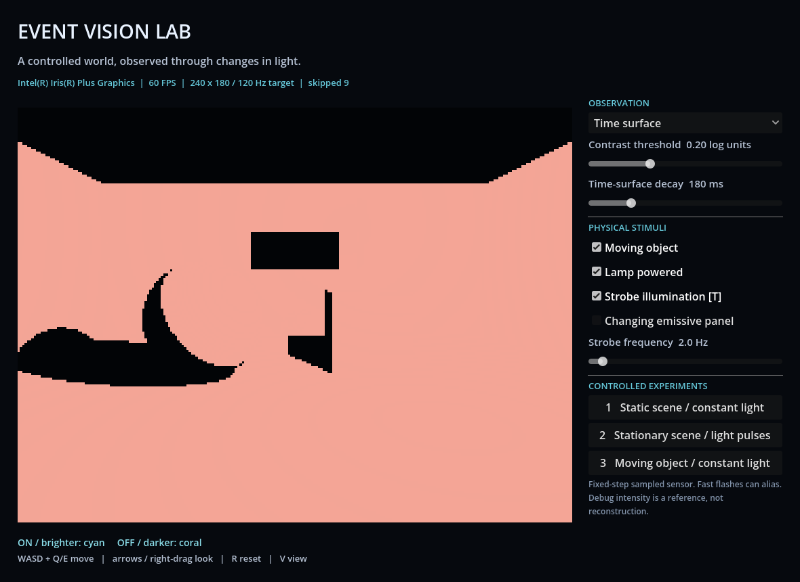

# Godot shader prototype

Implemented November 22, 2026, on this Windows laptop. Purpose: **a controllable event-vision simulation without a physical event camera**. The artifact is a shader laboratory, with no game objective or asset-production requirement.

## Run

From `D:\ChatGPT\Event Game`:

```powershell
.\run-lab.ps1
```

Or double-click [Run Event Vision Lab.cmd](../Run%20Event%20Vision%20Lab.cmd). Open the editable project with:

```powershell
.\run-lab.ps1 -Editor
```

The project is [prototype/project.godot](../prototype/project.godot). The downloaded standard Windows Godot executable is local to `tools/godot/4.7.2/`; no global installation or PATH change is required. The `_sc_` marker makes the editor portable. Normal project shader-cache access may still require permission outside the agent's restricted filesystem; the successful GPU runs used normal user-cache access.

Vulkan is tested. `-Driver d3d12` is an available **untested** alternative. Compatibility/OpenGL cannot run this compute-shader implementation. Headless Godot disables the real RenderingDevice and is suitable for import checks, not these GPU tests.

## Controls and experiments

| Control | Effect |
| --- | --- |
| WASD; Q/E | Move the virtual camera horizontally; lower/raise it |
| Arrow keys or right-drag over the image | Look around |
| 1 | Freeze object/panel changes, constant lamp; scene should disappear from event view after history decays |
| 2 | Stationary scene with pulsed lighting; events remain despite no motion |
| 3 | Moving object under constant illumination |
| T / strobe checkbox | Toggle physical lamp modulation |
| R | Initialize the sensor reference from the current sample and clear history |
| V / observation selector | Cycle time surface, raw-display window, reference intensity |
| Threshold slider | Change the ON/OFF log-contrast threshold together |
| Decay slider | Change time-surface persistence |
| Other stimulus controls | Toggle lamp, moving object, changing emissive panel; adjust strobe frequency |

Cyan denotes ON/brighter events; coral denotes OFF/darker events. The default starts with light pulses and a moving object. A strobe can flood whole surfaces with events. Under multiplicative illumination changes, log differences can be similar across different albedos: an event visualization is not guaranteed to reveal the hidden texture. This is part of the intended intuition, rather than a special edge-reveal effect.

The reference intensity mode is **debug ground truth**, not grayscale reconstructed from events. It is explicitly selected and labeled.

## Architecture

1. A GPU compute shader analytically intersects a small room, spheres, and a box, including a shadow ray to a point light.
2. It computes deterministic linear RGB radiance from simple materials, fixed ambient illumination, direct lighting and a specular term. A panel emits a controllable changing pattern. Strobe changes the lamp in this scene calculation.
3. Linear luminance feeds the logarithmic threshold sensor. Persistent FP32 per-pixel state retains the contrast reference, previous log intensity, and last ON/OFF crossing times.
4. Each sample accounts for multiple threshold crossings and retains residual contrast. The most recent crossing time is interpolated within the sampled interval.
5. A separate canvas shader visualizes event history. Display-only tone mapping applies in the debug intensity mode, downstream of sensing.

The state and images remain on the GPU during normal interaction; there is no per-frame CPU image readback. Sensor and world calculation run in the same kernel for this first version; the input model can later be replaced with a more practical scene renderer. It currently uses neither imported 3D assets nor Godot's stock 3D lighting pipeline.

At a **120 Hz fixed simulation step**, multiple newly rendered scene samples can be dispatched per 60 Hz display frame. Camera pose is interpolated across those substeps. The shader scene is recomputed each time, rather than reusing one viewport image. The UI exposes skipped intervals if the scheduler cannot keep up. Missed intervals advance the scene clock and cannot be recovered from endpoint interpolation.

## What is validated

The same sensor kernel is exercised on an actual local GPU device by [sensor_tests.gd](../prototype/tests/sensor_tests.gd):

```powershell
.\run-lab.ps1 -Validate
```

All **16 checks passed**: initialization, static input, multiple ON/OFF crossings, retained residual, last-crossing timestamp, independent polarity thresholds, a low-intensity FP32 input, unchanged rendered scene, illumination-only response, object motion, and both missed/captured strobe transitions.

Evidence: [GPU checks and timing](evidence/2026-11-22/godot-sensor-tests.json), [test log](evidence/2026-11-22/godot-sensor-tests.log).

| Measurement on Intel Iris Plus | Result | Meaning |
| --- | ---: | --- |
| World + sensor, synchronous local GPU device | Median 0.879 ms; p95 0.954 ms/sample | 240×180; 40 warmup + 120 timed samples; includes submission/synchronization; excludes UI |
| Final interactive configuration, 12-second run | Median 16.666 ms; p95 16.729 ms/display interval | Actual wall-clock process intervals after two-second warmup; roughly 60 FPS |
| Sensor scheduling in that run | 120 Hz target; zero skipped intervals after warmup | Nine skipped intervals during startup; includes GPU compilation/setup transients |

The runtime is capped at 60 FPS with VSync disabled. The initial VSync run produced roughly 30 FPS despite the fast sensor kernel; the capped configuration resolved that observed limitation. Earlier runtime JSON files were exploratory and used engine-provided, potentially smoothed delta times. Use **[godot-runtime-final.json](evidence/2026-11-22/godot-runtime-final.json)** for the corrected wall-clock profile and **[its log](evidence/2026-11-22/godot-runtime-final.log)**.

Profile and capture again, replacing the current final profile:

```powershell
.\run-lab.ps1 -ProfileSeconds 12 -CapturePath 'D:\ChatGPT\Event Game\docs\evidence\2026-11-22\godot-preview.png'
```

This short run establishes an operable minimal setup. It does not establish long-duration thermal stability, accurate input-to-photon latency, or performance of more complex scenes. A native desktop capture attempt was interrupted when its tool session expired and the app window was no longer available; layout inspection instead used the app's own rendered output below.



## Fidelity limits

- An ideal deterministic sensor, not a calibrated physical event camera. No noise, threshold mismatch, refractory period, photoreceptor bandwidth or bandwidth saturation yet.
- Fixed sampled-time approximation. A flash completely between samples can be missed; the GPU tests deliberately demonstrate this. High strobe settings are experiments in aliasing, not a promise of accurate capture.
- Per-pixel crossing counts and most recent ON/OFF times are computed. A globally ordered `(x,y,t,p)` event stream is **not yet exported**, and every individual crossing time is not retained. The raw view bins recent events into the display interval.
- The analytic world has simple direct illumination and hard shadows. Fixed ambient is an approximation; there is no simulated global illumination, refraction, multi-bounce reflection, calibrated photometry, lens model or imported practical environment.
- Debug RGB is ground truth. Learned reconstruction, flow, binning/ROI modules, and real-data validation remain future work.

The next useful fidelity work is to select a practical observation scenario and validate its geometry, material and lighting behavior; then compare the sensor model against real event data or published reference simulations. Game development is optional.

## Runtime provenance and deferred host

Downloaded from the [official Godot Windows page](https://godotengine.org/download/windows/), version `4.7.2.stable.official.ed1daf0bf`. Windows reported a valid Authenticode signature from Prehensile Tales B.V. ZIP SHA-256:

```text
731980F9608D61333E5BAF54A2EF17210ACC7A538446C0CB9969F002ACA1E953
```

No OpenAI API, Python dependency, event-camera hardware, or GPU driver installation was needed. The project uses standard Godot/GLSL and can later be tried on Ubuntu with a supported GPU context; `--headless` alone is not a GPU execution path. The user-designated TITAN RTX Ubuntu host, `ssh vilab204`, has not been contacted.
